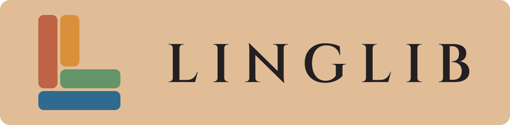

<p align="center">
  
</p>

[](https://github.com/linglib-community/linglib/actions/workflows/ci.yml)
[](https://leanprover.github.io/)
[](https://github.com/leanprover-community/mathlib4)
[](LICENSE)

A Lean 4 library for formal linguistics across semantics, syntax, pragmatics, morphology, phonology, and processing.

## About

Linglib is a community-maintained library of linguistic theory in [Lean 4](https://lean-lang.org/). 
It states definitions and results from the literature on shared foundations, so that work in one area can be cumulatively built on and compared against work in another.

Linglib is under active development. Finding the right foundational definitions is an iterative, trial-and-error process that requires extensive discussion within the community. Most of the code in the library was written with AI assistance and needs more extensive review. Please report problems on the [issue tracker](https://github.com/linglib-community/linglib/issues). Authors whose work appears here can ask for a correction or for its removal.

## Principles

- **The library formalizes existing work.** Every result corresponds to a claim in the published or publicly circulated literature. The library does not propose new linguistic analyses; a comparison or synthesis that no source makes is outside its scope.
- **Theories share definitions.** Competing accounts of a phenomenon are stated over the same types and operations, so that where they agree or disagree can be proved.
- **Descriptive categories come from the field.** The library uses established resources such as WALS, Universal Dependencies, PHOIBLE, and the Leipzig glossing rules, and takes its terminology from the literature.
- **Each study follows its paper.** A study file formalizes one paper at that paper's level of detail and depends only on work published before it. Bibliographic details are checked against the publication.
- **Conclusions are derived.** A prediction is proved from the definitions of the model. It is not written into a definition or entered as a table of expected values. An unfinished proof is marked `sorry`; the statement is not weakened to make it provable.
- **Mathematics comes from mathlib.** Probability, order, and algebra use mathlib's definitions and conventions. The library adds a new structure only when existing ones cannot express what is needed.
- **Existing code is revised when a new paper requires it.** Additions are expected to reuse the shared definitions. When a paper shows that a shared definition is inadequate, the definition is changed and the files that use it are updated.
- **Every file has a source.** A file corresponds to a paper, a documented empirical pattern, or a framework used by several papers.

## Building

```bash
lake exe cache get  # Get mathlib cache
lake build
```

## Using Linglib in your own Lake project

Linglib pins a specific toolchain (currently **Lean v4.36.0 / mathlib v4.36.0**), so your project's `lean-toolchain` must match. Add to your `lakefile.lean`:

```lean
require linglib from git
  "https://github.com/linglib-community/linglib" @ "v4.36.0"
```

(Use `@ "main"` to track the latest development instead of the pinned release.)

Then `import Linglib` — or, more selectively, e.g. `import Linglib.Pragmatics.Probabilistic.Basic`.

## Links

- **Project site & API docs:** [linglib.io](https://linglib.io/), with the [bibliography](https://linglib.io/bibliography/).
- **Contributing:** see [CONTRIBUTING.md](CONTRIBUTING.md).

## License

The code is Apache 2.0 — see [LICENSE](LICENSE). Imported datasets keep their own licences and citations, listed in [Linglib/Data/README.md](Linglib/Data/README.md).
